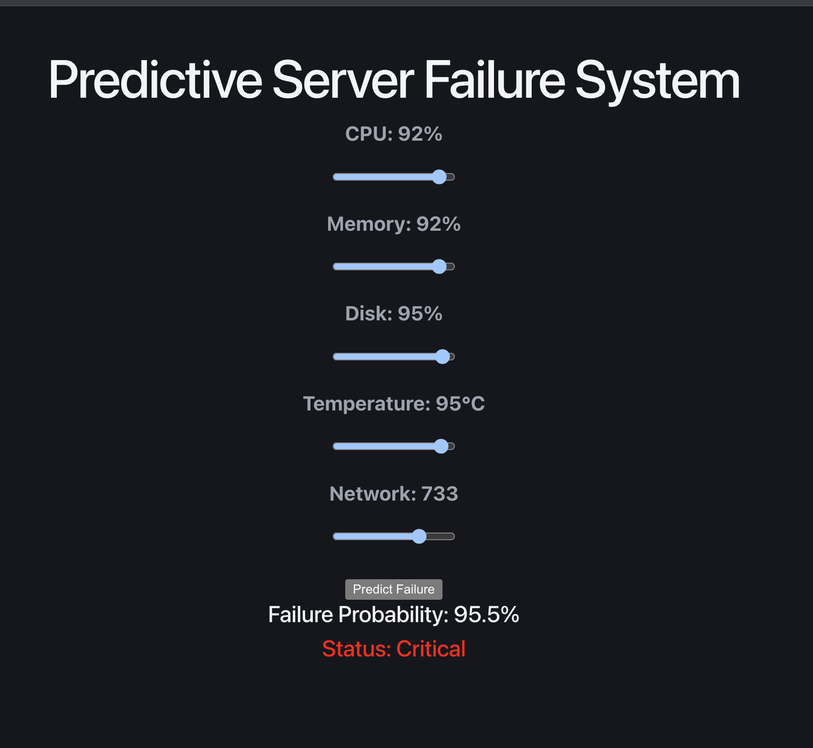
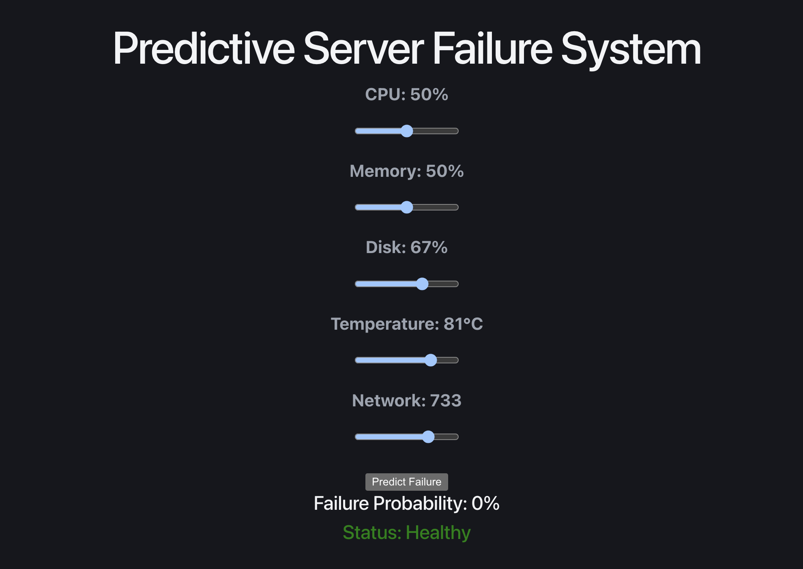
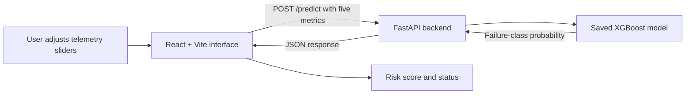
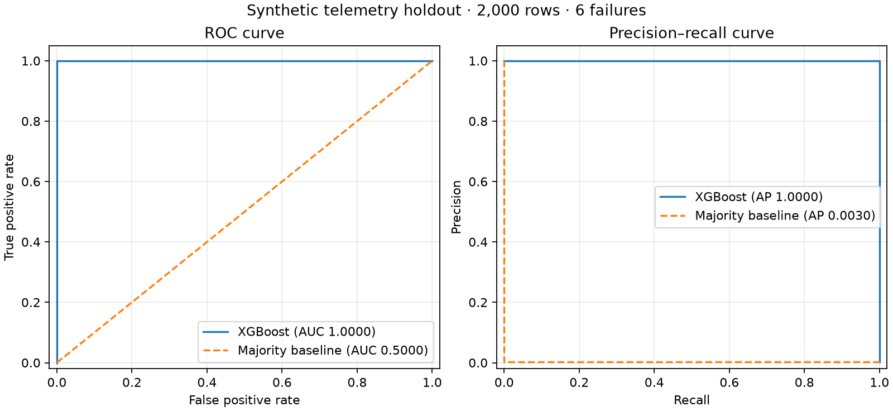
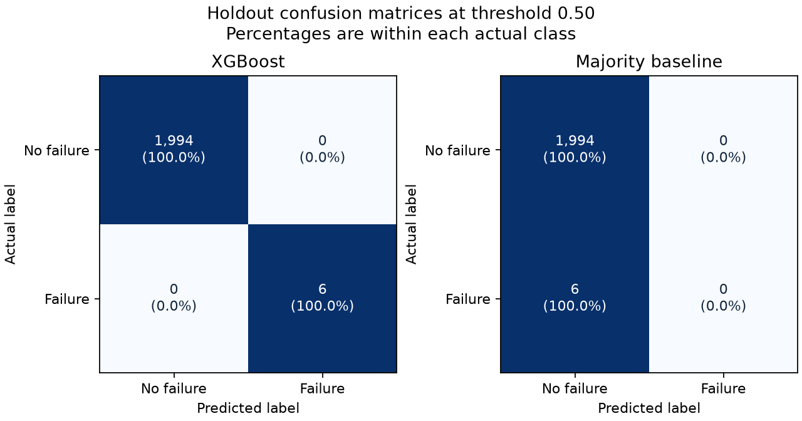

# Predictive Server Failure System

**Full-stack machine learning prototype for exploring server-failure risk using simulated infrastructure telemetry.**

Built with **React**, **FastAPI**, and **XGBoost**, the application lets users adjust server metrics, request a prediction from a Python API, and view the resulting risk score in an interactive dashboard.

> **Project scope:** This is an educational proof of concept using **synthetic, rule-labeled data**. The inputs are entered manually; the application does not currently collect live server telemetry or provide validated real-world failure forecasts.

[**Frontend demo**](https://infrastructure-failure-prediction-1.onrender.com/) · [**API documentation**](https://infrastructure-failure-prediction-2.onrender.com/docs) · [**GitHub repository**](https://github.com/Rimmii7702/infrastructure-failure-prediction)

## Dashboard preview



<details>
<summary>View an example of a lower-risk configuration</summary>



</details>

## What it does

- **Interactive telemetry inputs:** Adjust CPU utilization, memory utilization, disk utilization, temperature, and network activity using sliders.
- **ML-powered risk score:** Submit the five metrics to a FastAPI endpoint that loads a pre-trained XGBoost classifier and returns a failure-class probability as a percentage.
- **Human-readable status:** The React interface categorizes the returned score as **Healthy** (under 30%), **Warning** (30% to under 70%), or **Critical** (70% and above). These are UI thresholds, not validated operational alert thresholds.
- **Documented API:** Explore the backend through FastAPI's generated Swagger UI.
- **Exploratory analysis:** Inspect the included synthetic telemetry dataset, notebook, and model-wide feature-importance figure.

## Architecture



The frontend sends a JSON request with five numeric features. The backend creates a pandas DataFrame with the expected column names, obtains `predict_proba` from the loaded model, and returns the positive-class score as `failure_probability` on a **0–100 percentage scale**, rounded to two decimals.

## Technology stack

| Layer | Technologies | Purpose |
| --- | --- | --- |
| Frontend | React, Vite, Axios | Telemetry controls, API requests, risk display |
| Backend | Python, FastAPI, Uvicorn | REST endpoint and model inference |
| Machine learning | XGBoost, scikit-learn, pandas, joblib | Model training, evaluation, serialization, inference |
| Data and exploration | NumPy, pandas, Jupyter, Matplotlib | Simulated telemetry, exploration, feature importance |
| Deployment | Render | Hosted frontend and backend links |

## Dataset and modeling approach

The included `backend/generate_data.py` script generates **10,000 simulated telemetry records** with these columns:

| Feature | Generated range |
| --- | --- |
| `cpu` | 0–100 |
| `memory` | 0–100 |
| `disk` | 0–100 |
| `temperature` | 20–95 |
| `network` | 0–1,000 |

A `failure` label is assigned when **CPU > 90**, **memory > 85**, **and temperature > 80** simultaneously. The checked-in dataset contains **9,970 non-failure cases and 30 failure cases (0.3%)**.

The provided `backend/train.py` defines an **80/20 random train/test split** with `random_state=42`, fits an `XGBClassifier`, prints accuracy, and saves a model artifact and a feature-importance plot. An already serialized model is included at `backend/models/failure_model.pkl` for inference.

### Model-wide feature importance


This image illustrates overall model feature importance. The deployed application **does not currently compute per-prediction explanations**.

## Synthetic telemetry evaluation

The results below come from a fresh XGBoost evaluation model. The checked-in pickle has the expected five features and 100 boosting rounds, but the repository has no saved split or training record that ties it to specific rows. Its held-out performance is therefore unverified.

### Method

1. Reserve a stratified 20% holdout using seed `42`. The training partition contains 8,000 rows and 24 failures. The holdout contains 2,000 rows and 6 failures. Positive-class prevalence is **0.3%** in the full dataset and in both partitions.
2. Fit a fresh XGBoost model and a majority-class baseline on each training fold in shuffled, five-fold stratified cross-validation, using only the 8,000 training rows. The fold results describe sensitivity to the split. The model settings and 0.50 classification threshold were fixed before scoring the holdout.
3. Fit both models on all 8,000 training rows and score the same untouched holdout. Use only the five telemetry features. The CSV has zero exact duplicate feature rows. No preprocessing, resampling, early stopping, or threshold selection uses holdout data.
4. Calculate precision, recall, and F1 for the failure class at a threshold of 0.50. Calculate ROC-AUC and average precision from the positive-class scores. PR-AUC is reported as scikit-learn's average precision, which weights precision by changes in recall without trapezoidal interpolation. [Average precision documentation](https://scikit-learn.org/stable/modules/generated/sklearn.metrics.average_precision_score.html)

### Held-out results

| Model | Accuracy | Precision | Recall | F1 | ROC-AUC | PR-AUC (AP) | TN / FP / FN / TP |
| --- | ---: | ---: | ---: | ---: | ---: | ---: | --- |
| Evaluation XGBoost | 1.0000 | 1.0000 | 1.0000 | 1.0000 | 1.0000 | 1.0000 | 1,994 / 0 / 0 / 6 |
| Majority-class baseline | 0.9970 | 0.0000 | 0.0000 | 0.0000 | 0.5000 | 0.0030 | 1,994 / 0 / 6 / 0 |

The majority-class baseline predicts no failures. Its precision is reported as zero because it makes no positive predictions. Its average precision equals the positive-class prevalence.





### Cross-validation and limitations

Across the five validation folds, XGBoost had mean precision **1.0000**, recall **0.9200**, F1 **0.9556**, ROC-AUC **0.9997**, and average precision **0.9658**. Recall ranged from **0.8000 to 1.0000** and average precision from **0.8625 to 1.0000**. Two folds each missed one failure. The majority baseline detected zero failures across all five folds and had mean average precision **0.0030**. Each validation fold contained only four or five failures. Fold ranges and standard deviations are descriptive because the training sets overlap and stratification keeps the class ratio nearly fixed. [Stratified cross-validation documentation](https://scikit-learn.org/stable/modules/cross_validation.html#cross-validation-iterators-with-stratification-based-on-class-labels)

All 10,000 labels match the rule applied to CPU, memory, and temperature. The evaluation measures recovery of that rule. The dataset has no observed outages, time sequences, or lead-time labels for testing advance warning, and the scores do not establish real-world performance or probability calibration. With only six positive holdout rows, a single additional miss would change recall by **16.7 percentage points**.

### Reproduce the evaluation

From the repository root in a dedicated Python 3.11 virtual environment:

```bash
python -m pip install -r requirements-evaluation.txt
python -m backend.evaluate
```

The published run used Python 3.11.15. The command fits fresh estimators in memory and writes figures, [metrics and fold details](evaluation/metrics.json), and [held-out scores by zero-based dataset row](evaluation/holdout_predictions.csv) to `evaluation/`. The metrics file records the input checksum, model settings, split sizes, and package versions.

## Run locally

### Prerequisites

- Python 3.11 (the repository includes `runtime.txt` specifying Python 3.11.7)
- Node.js 22.13 or later in the 22.x line, or Node.js 24 LTS, with npm
- Git

### 1. Clone and install backend dependencies

```bash
git clone https://github.com/Rimmii7702/infrastructure-failure-prediction.git
cd infrastructure-failure-prediction
python -m venv .venv
```

Activate the virtual environment on **macOS or Linux**:

```bash
source .venv/bin/activate
```

Or on **Windows PowerShell**:

```powershell
.venv\Scripts\Activate.ps1
```

Install dependencies from the repository root:

```bash
python -m pip install -r requirements.txt
```

### 2. Start the API

From the repository root, start the API with the checked-in model:

```bash
python -m uvicorn backend.api:app --reload
```

- Health endpoint: `http://127.0.0.1:8000/`
- Interactive API docs: `http://127.0.0.1:8000/docs`
- Prediction endpoint: `POST http://127.0.0.1:8000/predict`

### 3. Start the React frontend

Open a second terminal at the repository root:

```bash
cd frontend
npm ci
cp .env.example .env.development.local
npm run dev
```

In Windows PowerShell, use `Copy-Item .env.example .env.development.local` for the copy step.

Open the local URL printed by Vite (normally `http://localhost:5173`). The example sets `VITE_API_BASE_URL` to `http://127.0.0.1:8000`. To use a different backend, set the variable to its base URL and restart Vite.

### 4. Send a sample API request

With the local backend running, use:

```bash
curl -X POST http://127.0.0.1:8000/predict \
  -H "Content-Type: application/json" \
  -d '{"cpu":95,"memory":90,"disk":70,"temperature":88,"network":500}'
```

The response contains one numeric field, `failure_probability`, on a 0–100 percentage scale. Send all five fields as finite JSON numbers within the inclusive ranges in the dataset table. Missing, invalid, or out-of-range fields return HTTP 422 with validation details.

## Verification

From the repository root with the Python virtual environment active:

```bash
python -m pip install -r requirements-dev.txt
python -m unittest discover -s tests -v
```

Run the frontend checks from `frontend/` after `npm ci`:

```bash
npm run lint
npm run build
```

### GitHub Actions

CI runs on pushes to `main` and pull requests targeting it. The Backend job runs the API tests with the checked-in model. The Frontend job installs locked dependencies, runs lint, and builds the app.

To view results on GitHub, open **Actions**, select **CI**, and choose a run. Select **Backend** and expand **Run API tests** for the test output, or select **Frontend** for lint and build logs. You can also open the run from a pull request's **Checks** tab. [Viewing workflow runs](https://docs.github.com/en/actions/how-tos/monitor-workflows/view-workflow-run-history)

## Render deployment

The frontend production build uses the hosted API URL in `frontend/.env.production`. To point it at a different backend, set `VITE_API_BASE_URL` in the frontend service's Render environment and rebuild. Vite reads this variable at build time. [Vite environment variables](https://vite.dev/guide/env-and-mode) · [Render environment settings](https://render.com/docs/configure-environment-variables)

The backend can start with `python -m uvicorn backend.api:app --host 0.0.0.0 --port "$PORT"` from the repository root. An existing start command using `api:app` from `backend/` also works.

## Repository structure

```text
.
├── assets/                   # Dashboard screenshots and model-importance image
├── backend/
│   ├── api.py                # FastAPI health and prediction endpoints
│   ├── evaluate.py           # Separate stratified evaluation
│   ├── generate_data.py      # Synthetic telemetry generator
│   ├── predict.py            # Example inference script
│   ├── train.py              # XGBoost training script
│   └── models/
│       └── failure_model.pkl # Serialized model used by the API
├── data/
│   └── telemetry.csv         # 10,000 simulated, labeled records
├── evaluation/               # Measured scores and plots
├── frontend/                 # React + Vite interface
├── notebooks/
│   └── exploration.ipynb     # Exploratory data analysis
├── tests/
│   └── test_api.py           # API integration tests with the checked-in model
├── requirements-dev.txt
├── requirements-evaluation.txt
├── requirements.txt
└── runtime.txt
```

## Current limitations and next improvements

- **Synthetic benchmark:** Failure labels are generated by a rule and do not represent observed server failures.
- **Manual inputs:** The app demonstrates on-demand prediction, not continuous telemetry ingestion or production monitoring.
- **Interpretability:** The repository includes a global feature-importance graphic, not per-request explanations.

## Author

**Rimmi Parmar** · M.S. Computer Science, The University of Texas at Dallas  
[GitHub](https://github.com/Rimmii7702) · [LinkedIn](https://www.linkedin.com/in/rimmi-parmar/)
