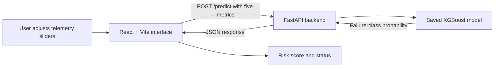
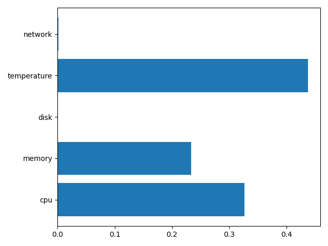

# Predictive Server Failure System

**Full-stack machine learning prototype for exploring server-failure risk using simulated infrastructure telemetry.**

Built with **React**, **FastAPI**, and **XGBoost**, the application lets users adjust server metrics, request a prediction from a Python API, and view the resulting risk score in an interactive dashboard.

> **Project scope:** This is an educational proof of concept using **synthetic, rule-labeled data**. The inputs are entered manually; the application does not currently collect live server telemetry or provide validated real-world failure forecasts.

[**Frontend demo**](https://infrastructure-failure-prediction-1.onrender.com/) · [**API documentation**](https://infrastructure-failure-prediction-2.onrender.com/docs) · [**GitHub repository**](https://github.com/Rimmii7702/infrastructure-failure-prediction)

## Dashboard preview


<details>
<summary>View an example of a lower-risk configuration</summary>


</details>

## What it does

- **Interactive telemetry inputs:** Adjust CPU utilization, memory utilization, disk utilization, temperature, and network activity using sliders.
- **ML-powered risk score:** Submit the five metrics to a FastAPI endpoint that loads a pre-trained XGBoost classifier and returns a failure-class probability as a percentage.
- **Human-readable status:** The React interface categorizes the returned score as **Healthy** (under 30%), **Warning** (30% to under 70%), or **Critical** (70% and above). These are UI thresholds, not validated operational alert thresholds.
- **Documented API:** Explore the backend through FastAPI's generated Swagger UI.
- **Exploratory analysis:** Inspect the included synthetic telemetry dataset, notebook, and model-wide feature-importance figure.

## Architecture



The frontend sends a JSON request with five numeric features. The backend creates a pandas DataFrame with the expected column names, obtains `predict_proba` from the loaded model, and returns the positive-class score as `failure_probability` on a **0–100 percentage scale**, rounded to two decimals.

## Technology stack

| Layer | Technologies | Purpose |
| --- | --- | --- |
| Frontend | React, Vite, Axios | Telemetry controls, API requests, risk display |
| Backend | Python, FastAPI, Uvicorn | REST endpoint and model inference |
| Machine learning | XGBoost, scikit-learn, pandas, joblib | Model training, evaluation, serialization, inference |
| Data and exploration | NumPy, pandas, Jupyter, Matplotlib | Simulated telemetry, exploration, feature importance |
| Deployment | Render | Hosted frontend and backend links |

## Dataset and modeling approach

The included `backend/generate_data.py` script generates **10,000 simulated telemetry records** with these columns:

| Feature | Generated range |
| --- | --- |
| `cpu` | 0–100 |
| `memory` | 0–100 |
| `disk` | 0–100 |
| `temperature` | 20–95 |
| `network` | 0–1,000 |

A `failure` label is assigned when **CPU > 90**, **memory > 85**, **and temperature > 80** simultaneously. The checked-in dataset contains **9,970 non-failure cases and 30 failure cases (0.3%)**.

The provided `backend/train.py` defines an **80/20 random train/test split** with `random_state=42`, fits an `XGBClassifier`, prints accuracy, and saves a model artifact and a feature-importance plot. An already serialized model is included at `backend/models/failure_model.pkl` for inference.

**Important evaluation caveat:** With only 0.3% positive examples, a naive model that always predicts “no failure” would achieve 99.7% accuracy. Accuracy alone does not establish useful failure detection. Precision, recall, F1, PR-AUC, calibration, and evaluation on realistic labeled telemetry would be important next steps. No independent performance claim is made here.

### Model-wide feature importance



This image illustrates overall model feature importance. The deployed application **does not currently compute per-prediction explanations**.

## Run locally

### Prerequisites

- Python 3.11 (the repository includes `runtime.txt` specifying Python 3.11.7)
- Node.js and npm suitable for the Vite version in `frontend/package.json`
- Git

### 1. Clone and install backend dependencies

```bash
git clone https://github.com/Rimmii7702/infrastructure-failure-prediction.git
cd infrastructure-failure-prediction
python -m venv .venv
```

Activate the virtual environment on **macOS or Linux**:

```bash
source .venv/bin/activate
```

Or on **Windows PowerShell**:

```powershell
.venv\Scripts\Activate.ps1
```

Install dependencies from the repository root:

```bash
python -m pip install -r requirements.txt
```

### 2. Start the API

Run this from the **`backend/` directory**, because the current API loads its model using a relative path:

```bash
cd backend
python -m uvicorn api:app --reload
```

- Health endpoint: `http://127.0.0.1:8000/`
- Interactive API docs: `http://127.0.0.1:8000/docs`
- Prediction endpoint: `POST http://127.0.0.1:8000/predict`

### 3. Start the React frontend

Open a second terminal at the repository root:

```bash
cd frontend
npm ci
npm run dev
```

Open the local URL printed by Vite (normally `http://localhost:5173`).

**Local development note:** The current `frontend/src/App.jsx` hard-codes the deployed Render API URL (`https://infrastructure-failure-prediction-2.onrender.com/predict`). Therefore, a locally running frontend **still calls the hosted backend** unless you change that URL to `http://127.0.0.1:8000/predict`. A configurable environment variable is a planned improvement.

### 4. Send a sample API request

With the local backend running, use:

```bash
curl -X POST http://127.0.0.1:8000/predict \
  -H "Content-Type: application/json" \
  -d '{"cpu":95,"memory":90,"disk":70,"temperature":88,"network":500}'
```

The response is JSON with one numeric field: `failure_probability`. Its value is a percentage from 0 to 100; the precise result depends on the included model artifact.

## Repository structure

```text
.
├── assets/                   # Dashboard screenshots and model-importance image
├── backend/
│   ├── api.py                # FastAPI health and prediction endpoints
│   ├── generate_data.py      # Synthetic telemetry generator
│   ├── predict.py            # Example inference script
│   ├── train.py              # XGBoost training script
│   └── models/
│       └── failure_model.pkl # Serialized model used by the API
├── data/
│   └── telemetry.csv         # 10,000 simulated, labeled records
├── frontend/                 # React + Vite interface
├── notebooks/
│   └── exploration.ipynb     # Exploratory data analysis
├── requirements.txt
└── runtime.txt
```

## Current limitations and next improvements

- **Synthetic benchmark:** Failure labels are generated by a rule and do not represent observed server failures.
- **Class imbalance:** The included dataset has only 30 positive cases. Additional evaluation metrics and class-aware splitting are needed before claiming predictive quality.
- **Manual inputs:** The app demonstrates on-demand prediction, not continuous telemetry ingestion or production monitoring.
- **Backend configuration:** The frontend uses a hard-coded hosted API URL; training and artifact scripts also have relative-path assumptions that should be standardized before a reliable retraining workflow is documented.
- **Input handling and reliability:** Typed request validation, frontend loading/error states, automated tests, and dependency pinning would strengthen the application.
- **Interpretability:** The repository includes a global feature-importance graphic, not per-request explanations.

## Author

**Rimmi Parmar** · M.S. Computer Science, The University of Texas at Dallas  
[GitHub](https://github.com/Rimmii7702) · [LinkedIn](https://www.linkedin.com/in/rimmi-parmar/)
